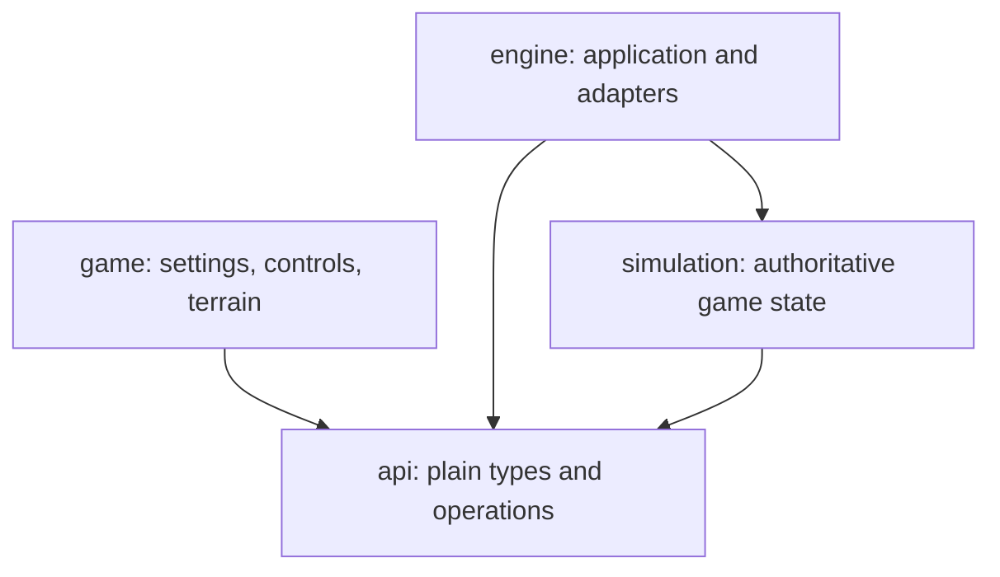

# Architecture and future work

## Purpose

This is a Minecraft clone, not a general-purpose engine project. Maintain a readable
game-facing API while keeping technical complexity behind explicit module boundaries.
This document describes the implementation, rather than a proposed rewrite.

## Modules and dependency direction

`game/` supplies callbacks and settings to `RunGame`. The application invokes them
through the API; it does not include or inspect game implementation files.

| Area | Responsibility | Excludes |
| --- | --- | --- |
| `api/` | Plain math/IDs, settings, input values, borrowed player/world/terrain handles | Platform types, matrices, GPU handles |
| `game/` | Default terrain, controls, settings, readable decisions | Collision/streaming math, raw input, service setup |
| `simulation/` | World/chunks, block definitions, physics, mining, player rules and feedback values | Windows, DirectX, XAudio2, asset loading |
| `engine/platform/` | Window lifetime, Windows messages, cursor and input collection | Player movement or mining rules |
| `engine/assets/` | Read manifests, join definitions with visual resource descriptions | World ownership or gameplay mutations |
| `engine/graphics/` | Device/resources, materials, terrain caches/rendering, camera matrices | Authoritative game decisions |
| `engine/audio/` | Resolve/load/play sounds | Mining or landing decisions |
| `engine/runtime/` | Application lifecycle, scheduling and composition | Default game terrain/controls |
| `engine/ui/` | HUD and diagnostic presentation | Authoritative world mutation |

CMake separates `game_api` (interface), `simulation` (CPU library), `runtime` (Windows
library) and `Engine` (game executable). Source-root visibility is intentionally simple;
CMake alone cannot forbid relative includes. `tools/check_boundaries.py` enforces
include directions during every build and through CTest.

## Ownership and lifetime

`Application` owns the window, input, renderer/camera, block catalog and asset adapter,
sound device, session and HUD. Declaration/destruction order keeps the window alive
for input/renderer shutdown and the catalog alive for the session.

`GameSession` owns world state, player, mining progress, movement state, debug commands,
and pending sound cues. Its world generator calls the game-provided terrain callback.
`BlockRegistry` stores immutable CPU definitions with session-local IDs and resource
names; it requires neither a renderer nor a file. `BlockAssets` loads manifest data
and independently uploads material textures through the renderer.

API handles borrow the session's state. `Terrain` borrows a single generated chunk.
Callbacks must not retain these handles or pass mutable references to worker threads.
No globals/service locator are used to discover runtime services.

World data is authoritative. CPU meshes, GPU buffers, crack textures and target labels
are disposable derived data. A single mining-progress object describes the current
interaction; there is no allocated gameplay object for every world voxel.

## Time, input and update order

Simulation duration is `SimulationTickSeconds` (1/20 second). The runtime accumulates
wall time and permits at most five catch-up ticks, discarding excess time after a long
stall. Mining and movement advance on that same simulation clock. This is a deliberate
correction to the previous mixed frame/mining and tick/movement clocks.

Each frame:

1. Process Windows messages and advance bounded world streaming.
2. Consume relative mouse motion, update look, and publish the direction to the session.
3. Accumulate time. For each due tick, consume input (pressed once, held repeatedly).
4. Run the game callback. Placement/mode switching are immediate validated operations;
   movement, jump and mining set intentions for the tick.
5. Apply movement/jump, collision and landing/footstep rules, then mining progress.
6. Interpolate the camera between previous/current player position for rendering.
7. Drain sound cues to the audio adapter; render terrain, debug lines and HUD.

Mouse look stays responsive per frame; targeting for gameplay uses the current
authoritative player eye position, not the interpolated render camera. The diagnostic
target overlay has its own farther-reaching camera ray and does not promise that its
displayed block is within the player's interaction reach.

## World availability and rendering changes

Chunks are 16×16 columns with fixed 0..255 Y bounds and compact stored height.
`TryGetBlock()` returns unavailable for unloaded chunks, distinct from loaded air.
Outside vertical bounds is known empty. Collision blocks unavailable cells; targeting
stops there. The legacy internal `GetBlock()` maps missing chunks to air and should
only be used where that fallback is intentional (e.g. diagnostics/spawn scan).

Every chunk has a content version and a load identity. A terrain-cache entry records
both for itself and its four horizontal neighbors. Single revisions use a recent-change
fast path. Missed revisions trigger a bounded reconciliation scan; unrelated meshes
remain cached. A reloaded chunk invalidates its old mesh even if its content version
matches a previous instance. GPU buffers remain per-frame and are reused/released
only after that frame's fence has completed.

Generation, meshing and uploads remain on the main thread with work budgets. The
existing 2 ms meshing deadline is checked between chunks, not inside one mesh build.
It is not a hard frame-time guarantee. Prioritize measured bottlenecks before threading.

The renderer implementation is split into device/pipeline setup (`device.cpp`),
frame lifecycle (`renderer.cpp`), texture/material handling (`block_materials.cpp`),
and terrain drawing (`terrain_renderer.cpp`). All DirectX details stay internal.

## Assets and build behavior

The full imported library remains under `assets/minecraft/`. `tools/stage_assets.py`
reads `blocks.tsv` and `player_sounds.tsv`, collects required cube textures, crack stages,
grass overlay, crosshair and converted WAVs, and incrementally copies referenced files
beside the executable. It never recursively deletes a destination directory; old files
from a previous full-copy build can remain harmlessly in that build directory.

New features that require other resource categories must extend staging. Asset import
and conversion are not currently reproducible from a checked-in importer; the manifests
and converted files are the existing source inputs. Do not pretend original imported
block models already work: rendering still uses cube previews.

## Validation

- `simulation_tests`: negative coordinates, availability, edits across unload/reload,
  raycasts, bounded catch-up/interpolation, mining duration/modes, headless placement,
  jump displacement and blocking at unloaded boundaries.
- `mesh_tests` (Windows): skipped world revisions preserve unrelated meshes; content
  changes and reload identities invalidate affected meshes. Uses CPU DirectXMath only.
- `architecture`: dependency/include rules.
- Windows smoke test: built standalone game rendered flat terrain, crosshair and HUD;
  F4 switched Survival to Creative. This does not validate every sound/input behavior.

Keep tests tied to external behavior and invariants rather than copying formulas into
another implementation. Run relevant checks again after changing those contracts.

## Deliberately deferred work

These are future tasks, not features delivered by the boundary refactor:

1. **Versioned persistence.** Edits currently remain in memory, survive chunk unloading,
   and disappear on process exit. Add a stable resource-name/state palette, world seed,
   schema version and safe writes. Flush/unload edits so exploration does not retain an
   unbounded map forever. Define missing-resource behavior before loading old worlds.
2. **Block states and shapes.** Separate definitions from orientation/state; add collision,
   selection and face-occlusion properties. Non-air currently means a solid cube.
3. **Chunk sections.** Consider smaller vertical rebuild/storage units when terrain height,
   lighting and block-state density justify the change. Public world operations must stay stable.
4. **Block entities and inventory.** Store chest/furnace state separately from ordinary voxels.
   Openability is currently metadata; no opening UI, inventory, tools or drops exists.
5. **Rendering features.** Add opaque/cutout/transparent paths, model geometry, texture animation,
   lighting and biome tinting deliberately. Profile meshing/draw/upload costs before choosing
   greedy meshing, texture arrays or another batching strategy.
6. **Jobs.** Build immutable chunk/neighborhood snapshots, attach versions, discard stale results,
   and define shutdown/cancellation before moving generation or meshing to workers. GPU ownership
   stays on the render side. A version number alone does not make shared memory thread-safe.
7. **Replay/networking.** Existing actions and CPU simulation provide a starting boundary, not
   deterministic multiplayer. Input edges are booleans, not a lossless event stream; multiple
   clicks between ticks can coalesce. Define command ordering/authority and reproducible seeds
   before promising replay or networking.

Do not introduce an ECS, scripting VM, plugin system, general event bus or extra backend
implementations until an actual feature needs them. Prefer incremental vertical changes
that extend the readable API and preserve the existing ownership contracts.
